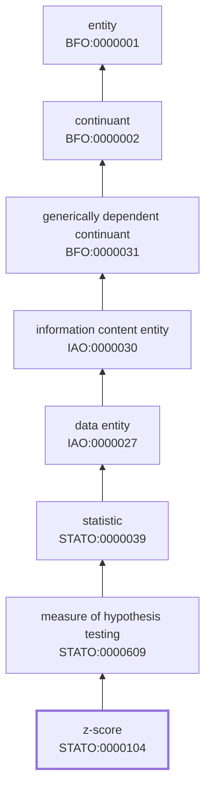

# z-score (STATO:0000104)

[All terms](README.md) · [Term table](../ontology_terms.csv)

- **Kind:** class
- **Source:** STATO
- **IRI:** <http://purl.obolibrary.org/obo/STATO_0000104>
- **Parent(s):** STATO:0000609

> A z-score (also known as z-value, standard score, or normal score) is a measure of the divergence of an individual experimental result from the most probable result, the mean. Z is expressed in terms of the number of standard deviations from the mean value.

## Spreadsheet rows

| Row | Requirement | Use case | Decision | Requirement text |
|---|---|---|---|---|
| T141 | TX-06 | transcriptomics | proposed | z-score of an expression value (standardised across samples or conditions) |
