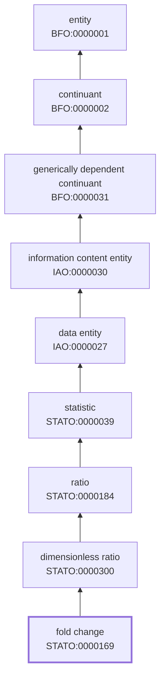

# fold change (STATO:0000169)

[All terms](README.md) · [Term table](../ontology_terms.csv)

- **Kind:** class
- **Source:** STATO
- **IRI:** <http://purl.obolibrary.org/obo/STATO_0000169>
- **Parent(s):** STATO:0000300

> Fold change is a number describing how much a quantity changes going from an initial to a final value or one condition to another condition

## Spreadsheet rows

| Row | Requirement | Use case | Decision | Requirement text |
|---|---|---|---|---|
| T145 | TX-08 | transcriptomics | open | Fold change between two conditions (log2 fold change of a DESeq2 result) |
