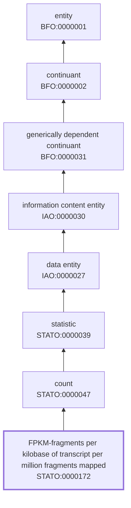

# FPKM-fragments per kilobase of transcript per million fragments mapped (STATO:0000172)

[All terms](README.md) · [Term table](../ontology_terms.csv)

- **Kind:** class
- **Source:** STATO
- **IRI:** <http://purl.obolibrary.org/obo/STATO_0000172>
- **Parent(s):** STATO:0000047

> FPKM, which is the expected fragments per kilobase of transcript per million fragments mapped is a metric used to report transcript expression event as generated by RNA-Seq using paired-end library. The calculated value results from 2 types of normalization, one to take into account the difference in reads counts associated with transcript length (at equal abundance, longer transcripts will have more reads than shorter transcripts) , (hence the 'per kilobase of transcript') and the other one to take into account different sequencing depth during distinct sequencing runs (hence the 'per millions mapped fragment'. The metric is specifically produced by cufflink software.\n\nRecommended use:\n\n-FPKM measure may be used for gene count comparisons within a sample. \n\n-FPKM measure is NOT suited for between sample comparisons.\n-FPKM measure is NOT suited for Differential Expression analysis.

## Spreadsheet rows

| Row | Requirement | Use case | Decision | Requirement text |
|---|---|---|---|---|
| T137 | TX-04 | transcriptomics | proposed | Normalised expression value with its unit (TPM, FPKM or RPKM) |
