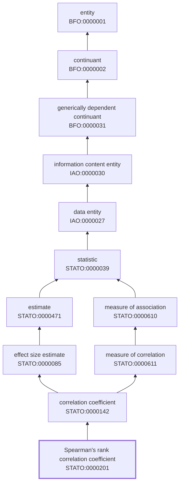

# Spearman's rank correlation coefficient (STATO:0000201)

[All terms](README.md) · [Term table](../ontology_terms.csv)

- **Kind:** class
- **Source:** STATO
- **IRI:** <http://purl.obolibrary.org/obo/STATO_0000201>
- **Parent(s):** STATO:0000142

> Spearman's rank correlation coefficient is a correlation coefficient which is a nonparametric measure of statistical dependence between two ranked variables. It assesses how well the relationship between two variables can be described using a monotonic function. If there are no repeated data values, a perfect Spearman correlation of +1 or −1 occurs when each of the variables is a perfect monotone function of the other.\nSpearman's coefficient may be used when the conditions for computing Pearson's correlation are not met (e.g linearity, normality of the 2 continuous variables) but may require a ranking transformation of the variables

## Spreadsheet rows

| Row | Requirement | Use case | Decision | Requirement text |
|---|---|---|---|---|
| T086 | PO-04 | paired_omics | open | Correlation coefficient of the pair |
| T155 | TX-14 | transcriptomics | open | Correlation of the expression profiles of two genes (or of a gene and a metabolite) |
