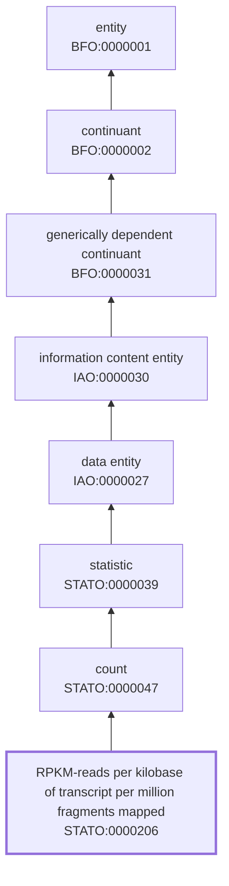

# RPKM-reads per kilobase of transcript per million fragments mapped (STATO:0000206)

[All terms](README.md) · [Term table](../ontology_terms.csv)

- **Kind:** class
- **Source:** STATO
- **IRI:** <http://purl.obolibrary.org/obo/STATO_0000206>
- **Parent(s):** STATO:0000047

> RPKM is a kind of count which numbers the sequence reads found per kilobase of transcript reported to million of sequence reads. RPKM is a metric generated by ERANGE software tool as reported by Mortazi et al, in 2008.\nThe metric has been enhanced and replaced by FPKM to better take into account splice variant. FKPM uses a statistical model to perform the computation.\n\nRecommended use:\n\n-RPKM measure may be used for gene count comparisons within a sample. \n\n-RPKM measure is NOT suited for between sample comparisons.\n-RPKM measure is NOT suited for Differential Expression analysis.

## Spreadsheet rows

| Row | Requirement | Use case | Decision | Requirement text |
|---|---|---|---|---|
| T138 | TX-04 | transcriptomics | proposed | Normalised expression value with its unit (TPM, FPKM or RPKM) |
