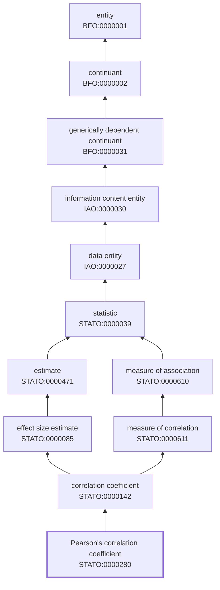

# Pearson's correlation coefficient (STATO:0000280)

[All terms](README.md) · [Term table](../ontology_terms.csv)

- **Kind:** class
- **Source:** STATO
- **IRI:** <http://purl.obolibrary.org/obo/STATO_0000280>
- **Parent(s):** STATO:0000142

> The Pearson's correlation coefficient is a correlation coefficient which evaluates two continuous variables for association strength in a data sample. It assumes that both variables are normally distributed and linearity exists. \nThe coefficient is calculated by dividing their covariance with the product of their individual standard deviations. It is a normalized measurement of how the two are linearly related.

## Spreadsheet rows

| Row | Requirement | Use case | Decision | Requirement text |
|---|---|---|---|---|
| T085 | PO-04 | paired_omics | proposed | Correlation coefficient of the pair |
| T154 | TX-14 | transcriptomics | proposed | Correlation of the expression profiles of two genes (or of a gene and a metabolite) |
