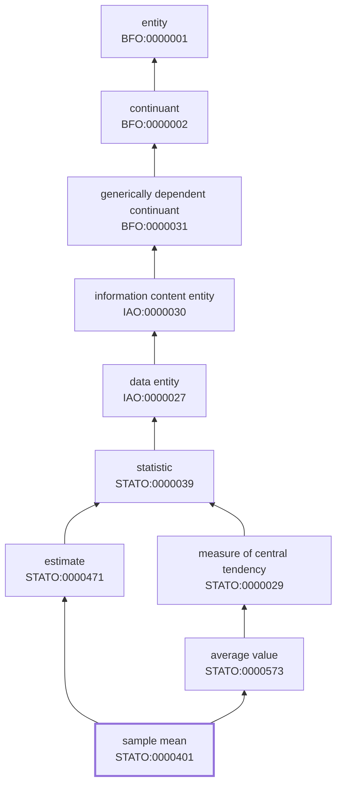

# sample mean (STATO:0000401)

[All terms](README.md) · [Term table](../ontology_terms.csv)

- **Kind:** class
- **Source:** STATO
- **IRI:** <http://purl.obolibrary.org/obo/STATO_0000401>
- **Parent(s):** STATO:0000471, STATO:0000573

> the sample mean of sample of size n with n observations is an arithmetic mean computed over n number of observations on a statistical sample.\nThe sample mean, denoted x¯ and read “x-bar,” is simply the average of the n data points x1, x2, ..., xn:\n\nx¯=x1+x2+⋯+xnn=1n∑i=1nxi\nThe sample mean summarizes the "location" or "center" of the data.\n\nthe sample mean is a measure of dispersion of the observations made on the sample and provides an unbias estimate of the population mean

## Spreadsheet rows

| Row | Requirement | Use case | Decision | Requirement text |
|---|---|---|---|---|
| T149 | TX-11 | transcriptomics | open | Mean of the normalised counts across samples (DESeq2 baseMean) |
