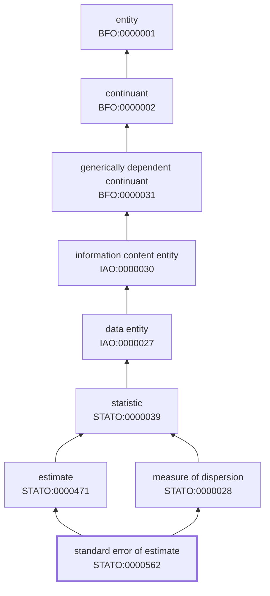

# standard error of estimate (STATO:0000562)

[All terms](README.md) · [Term table](../ontology_terms.csv)

- **Kind:** class
- **Source:** STATO
- **IRI:** <http://purl.obolibrary.org/obo/STATO_0000562>
- **Parent(s):** STATO:0000028, STATO:0000471

> The standard error is a measure of dispersion applied to estimates across hypothetical repeated random samples.\n\nIt is a measure of how precise an estimate of a statistical parameter is.\n\nThe standard error is the estimated standard deviation of an estimate.\n\nIt measures the uncertainty associated with the estimate. Compared with the standard deviations of the underlying distribution, which are usually unknown, standard errors can be calculated from observed data.

## Spreadsheet rows

| Row | Requirement | Use case | Decision | Requirement text |
|---|---|---|---|---|
| T148 | TX-10 | transcriptomics | open | Standard error of the log2 fold change (DESeq2 lfcSE) |
