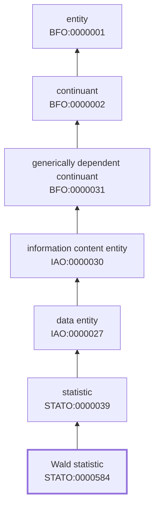

# Wald statistic (STATO:0000584)

[All terms](README.md) · [Term table](../ontology_terms.csv)

- **Kind:** class
- **Source:** STATO
- **IRI:** <http://purl.obolibrary.org/obo/STATO_0000584>
- **Parent(s):** STATO:0000039

> the Wald statistic is a statistic is used during a Wald test, a test of significance of the regression coefficient; it is based on the asymptotic normality property of maximum likelihood estimates, and is computed as:\n\nW = b * 1/Var(b) * b\n\nIn this formula, b stands for the parameter estimates, and Var(b) stands for the asymptotic variance of the parameter estimates. The Wald statistic is tested against the Chi-square distribution in the Wald test.

## Spreadsheet rows

| Row | Requirement | Use case | Decision | Requirement text |
|---|---|---|---|---|
| T147 | TX-09 | transcriptomics | proposed | Test statistic of the differential expression test (DESeq2 Wald statistic) |
