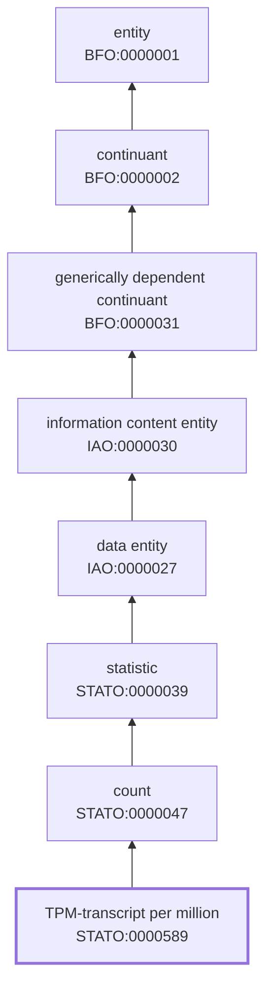

# TPM-transcript per million (STATO:0000589)

[All terms](README.md) · [Term table](../ontology_terms.csv)

- **Kind:** class
- **Source:** STATO
- **IRI:** <http://purl.obolibrary.org/obo/STATO_0000589>
- **Parent(s):** STATO:0000047

> TPM, which stands for Transcript Per Million,  is a data item produced during a normilization procedure of RNA-Seq data (i.e. transcription profiling reads produced by nucleic acid sequencing) and corresponds to the count per length of transcript (kb) per million reads mapped.\n\n-TPM considers the gene length and sequencing depth for normalization\n-TPM proposed as an alternative to RPKM due to inaccuracy in RPKM measurement (Wagner et al., 2012)\n-TPM is suitable for sequencing protocols where reads sequencing depends on gene length\n\n-TPM is RPKM scaled by a constant to make sure the sum of all values is 1 million.\n\n-TPM (transcript per million) = 1,000,000*θi/(ℓi*c), where c is a constant value, sum_[j](θj/ℓj), sum_[i]TPM=1,000,000\n\n\nRecommended use:\n\n-TPM measure is suited for gene count comparisons within a sample or between samples of the same sample group. \n\n-TPM measure is NOT suited for Differential Expression analysis.

## Spreadsheet rows

| Row | Requirement | Use case | Decision | Requirement text |
|---|---|---|---|---|
| T136 | TX-04 | transcriptomics | proposed | Normalised expression value with its unit (TPM, FPKM or RPKM) |
