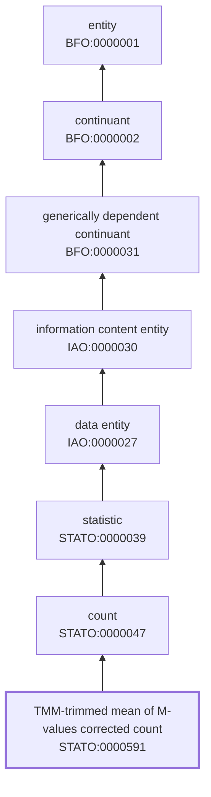

# TMM-trimmed mean of M-values corrected count (STATO:0000591)

[All terms](README.md) · [Term table](../ontology_terms.csv)

- **Kind:** class
- **Source:** STATO
- **IRI:** <http://purl.obolibrary.org/obo/STATO_0000591>
- **Parent(s):** STATO:0000047

> TMM or Trimmed Mean of M-Values is a  measurement datum which is the output of the TMM normalization procedure for RNA-Seq data proposed by Robinson and Oshlack (2010). A scaling normalization method for differential expression analysis of RNA-seq data.\nThe TMM procedure is doubly trimmed, by log-fold-changes  (sample k relative to sample r for gene g) and by absolute intensity (A g ).\n\nIt was first release as part of the R package edgeR, 10.1093/bioinformatics/btp616\n\n\nRecommended use:\n\n-TMM measure is suited for gene count comparisons within a sample or between samples of the same sample group. \n\n-TMM measure is suited for Differential Expression analysis.

## Spreadsheet rows

| Row | Requirement | Use case | Decision | Requirement text |
|---|---|---|---|---|
| T140 | TX-05 | transcriptomics | open | Normalisation method (library-size normalisation, TMM, variance-stabilising transformation) |
