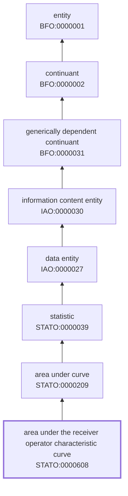

# area under the receiver operator characteristic curve (STATO:0000608)

[All terms](README.md) · [Term table](../ontology_terms.csv)

- **Kind:** class
- **Source:** STATO
- **IRI:** <http://purl.obolibrary.org/obo/STATO_0000608>
- **Parent(s):** STATO:0000209

> An area under the curve where the curve is the true positive rate and the range of interest is the false positive rate.

## Spreadsheet rows

| Row | Requirement | Use case | Decision | Requirement text |
|---|---|---|---|---|
| T123 | UN-07 | unsupervised | open | Model performance on the benchmark (area under the ROC curve, area under the precision-recall curve) |
